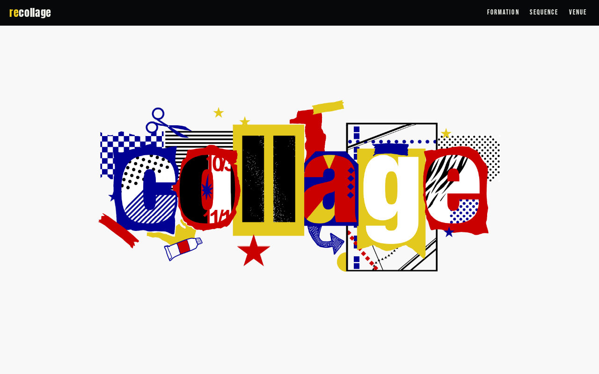

# graduation-live-2027 — recollage

卒業ライブ（2027-03-06 Sat – 03-07 Sun、サウンドステージ）公式サイト。
タイトルは **recollage**（第61回高専祭テーマ「collage」とリンク）。

本番: https://graduation-live-2027.pages.dev/ （Cloudflare Pages、URL は未告知）

## まず読むもの

| 知りたいこと                           | ファイル                                                      |
| -------------------------------------- | ------------------------------------------------------------- |
| 開発の始め方（環境構築）               | [docs/dev-guide.md](docs/dev-guide.md)                        |
| 開発の流れ（PR から本番まで）          | [docs/workflow.md](docs/workflow.md)                          |
| ブランチのルール                       | [docs/branch-rules.md](docs/branch-rules.md)                  |
| 運用ルール（本番・データの扱い）       | [docs/operations.md](docs/operations.md)                      |
| 技術スタックと理由                     | [docs/stack.md](docs/stack.md)                                |
| 出演バンド・タイムテーブル             | `src/data/bands.json` / `src/data/timetable.json`（ここが正） |
| サイト共通情報（日程・会場・タイトル） | `src/data/site.json`（ここが正）                              |

## 最低限の約束

- PR の宛先は dev。ブランチを切って PR で入れ、main へは dev からの昇格 PR だけが入る
- コンテンツは `src/data/` の JSON に書き、コンポーネントに直書きしない
- UI を変えたら PR にスクリーンショットを付ける

迷ったら上の表から辿る。開発の全体像は [docs/workflow.md](docs/workflow.md) にある。
